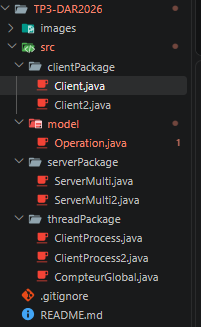
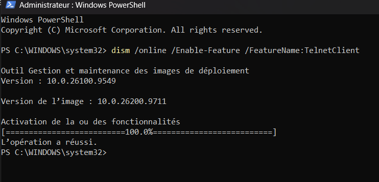
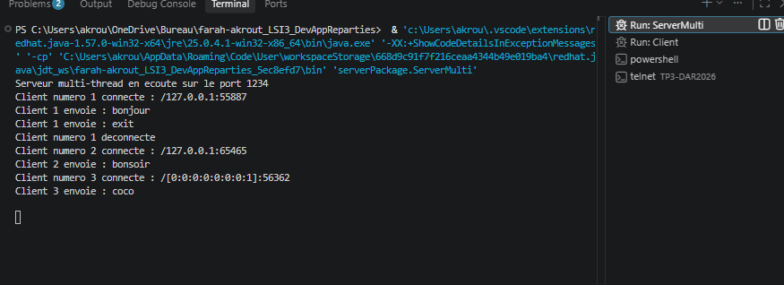
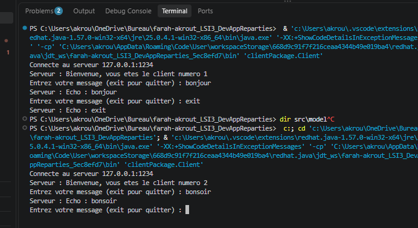
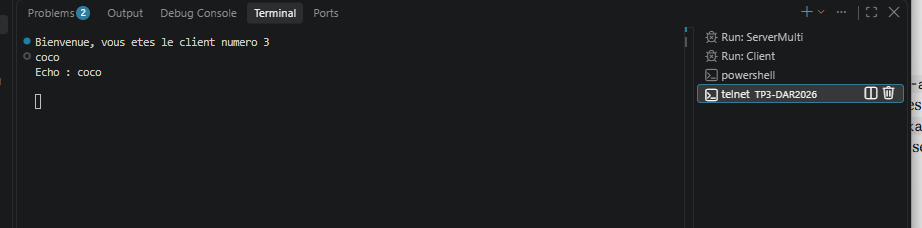
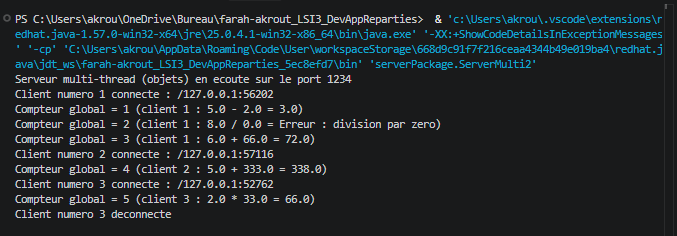
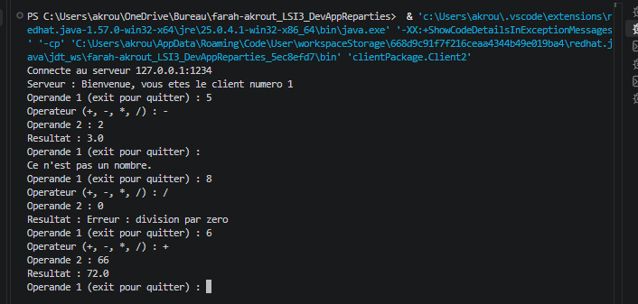
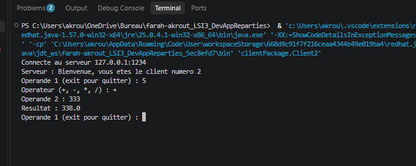
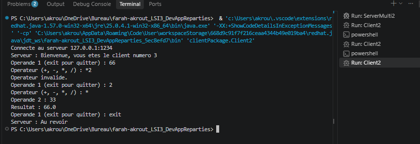

# TP3 - Serveur multi-thread (sockets TCP)

**Étudiante :** Farah Akrout, LSI3
**tp :** Développement d'applications réparties
**Dépôt :** TP3-DAR2026

## Objectif

Remplacer le serveur qui traite un seul client par un serveur **multi-thread** :

- **Activité 3-1** : accepter plusieurs clients en même temps.
- **Activité 3-2** : reprendre la calculatrice par objets (TP2), avec un thread par client et un compteur global partagé.

## Organisation du projet

# Activité 3-1 : acceptation de plusieurs clients

Le thread principal du serveur répète `accept()` dans une boucle. À chaque connexion, il :

1. incrémente un compteur, qui donne le **numéro d'ordre** du client ;
2. affiche ce numéro et l'adresse du client avec `getRemoteSocketAddress()` ;
3. crée un thread `ClientProcess` pour ce client, puis retourne aussitôt à `accept()`.

À sa connexion, le client reçoit son numéro d'ordre. Il peut ensuite envoyer des messages que le serveur renvoie en écho. Le message `exit` termine la communication.

## Telnet

Le client Telnet n'est pas activé par défaut sous Windows. Je l'ai activé avec `dism /online /Enable-Feature /FeatureName:TelnetClient` dans PowerShell administrateur.

## Test : trois clients en même temps

Trois clients sont connectés au serveur : deux clients Java et un client Telnet .

**Console du serveur**

Pour chaque client, le serveur affiche son numéro d'ordre, son adresse IP et son port source, différent d'un client à l'autre. Les messages arrivent dans l'ordre `bonjour` (client 1), `heyy` (client 3), `bonsoir` (client 2) : chaque client est servi indépendamment des autres.

Le client 2, qui est le client Telnet, apparaît avec l'adresse `[0:0:0:0:0:0:0:1]`. C'est l'adresse locale en IPv6 : Telnet a résolu `localhost` en IPv6, alors que les clients Java utilisent `127.0.0.1` (IPv4).

**Client Java n°1 et n°2**

**Client Telnet n°3**

## conclusion du tp3.1

- Un serveur mono-thread sert un client à la fois : tant qu'il dialogue avec lui, les autres attendent. Avec un thread par client, le serveur accepte de nouvelles connexions pendant qu'il en sert d'autres.
- Le numéro d'ordre est attribué par le thread principal au moment de `accept()` : il est unique et suit l'ordre d'arrivée.
- Quand un client se déconnecte, seul son thread se termine. Le serveur reste actif.
- Telnet permet de tester un serveur texte sans écrire de client.

---

# Activité 3-2 : calculatrice multi-thread par objets

## Principe

Le serveur reprend la structure de l'activité 3-1, avec une communication par **objets** (activité 2-2 du TP2) :

- le client envoie un objet `Operation` (opérande 1, opérateur, opérande 2) ;
- le thread `ClientProcess2` de ce client calcule et renvoie le résultat ;
- chaque client dialogue de façon indépendante avec son propre thread.

## Test : trois clients

**Console du serveur**

**Client 1**

Le client 1 montre une saisie refusée (`Ce n'est pas un nombre.`), une division par zéro (le serveur renvoie `Erreur : division par zero` sans planter) et deux calculs corrects.

**Client 2**

**Client 3**

Le client 3 montre un opérateur refusé (`*2`), puis un calcul correct, puis `exit` : le serveur répond `Au revoir`.

Les saisies refusées par le client n'atteignent jamais le serveur : elles ne font pas avancer le compteur. La division par zéro est reçue et traitée par le serveur : elle est comptée.

## conclusion tp3.2

- L'échange d'objets simplifie le protocole : un seul `writeObject` envoie l'opération avec ses types (`double`, `char`).
- Un thread par client rend les communications indépendantes : un client lent ne gêne pas les autres.
- Sans synchronisation, l'incrémentation du compteur (lecture, addition, écriture) de deux threads pourrait s'entremêler et faire perdre des valeurs. `synchronized` garantit un compteur cohérent et un affichage dans l'ordre.
- Limite : un thread par client ne convient pas à un très grand nombre de clients (un pool de threads serait préférable).

# Conclusion

Le serveur gère maintenant plusieurs clients en parallèle grâce à un thread par client. L'activité 3-2 ajoute le service de calculatrice par objets et un compteur global dont l'accès est synchronisé.
